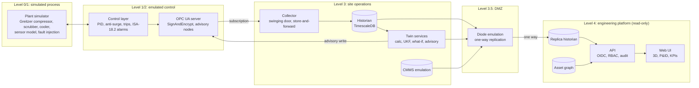

# Architecture: zones and data flow (C4 container view, simplified)

The advisory write from L3 to L2 is the only path towards control, and it never targets
control setpoints (ADR 0005). Level 4 has no path towards Level 3 or below.
